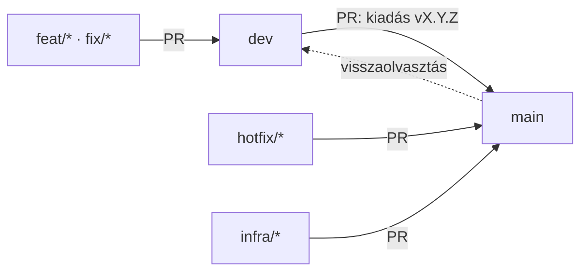

# Ágazási stratégia és kiadási folyamat

Ez a dokumentum az Olvasóka fejlesztésének kötelező menete, embereknek és AI-ágenseknek egyaránt.
Ha bármi ellentmond neki, ez az irányadó; a részletes indoklás a [specifikáció](specifikacio.md) N10
pontjában és döntési naplójában (2.9) van.

## 1. Környezetek

| Környezet | Ág | Cím | Kik használják |
|---|---|---|---|
| **Éles** | `main` | https://mangyal.github.io/olvasoka/ | a felhasználók (gyerekek, szülők, tanító) |
| **Fejlesztői** | `dev` | https://mangyal.github.io/olvasoka/dev/ | fejlesztés és kipróbálás; fejlécben piros „DEV” címke |

Mindkettőt a `.github/workflows/deploy.yml` teszi ki: minden `main` vagy `dev` pushra a teljes oldalt
összerakja (main → gyökér, dev → `/dev/`), majd füstteszt fut az élő oldalon (`e2e/smoke.mjs`).
Egy `dev` push az élest a változatlan `main`-ből építi újra, így az éles tartalma nem változik.

## 2. Ágak

| Ág | Honnan ágazik | Hova megy (PR) | Mire |
|---|---|---|---|
| `main` | – | – | Éles. Közvetlen push tilos, csak PR-ral változik. |
| `dev` | – | `main` (kiadás) | Fejlesztői; minden új munka ide fut be. |
| `feat/<rövid-név>` | `dev` | `dev` | Új funkció (pl. `feat/szotag-takaras`). |
| `fix/<rövid-név>` | `dev` | `dev` | Nem sürgős hibajavítás. |
| `hotfix/<rövid-név>` | `main` | `main` | Sürgős javítás élesben lévő hibára. |
| `infra/<rövid-név>` | `main` | `main` | Workflow-k, kiadási szkriptek, fejlesztési folyamat (pl. ez a fájl). |

A `main`-be csak `dev`, `hotfix/*` vagy `infra/*` ágból nyitható PR; ezt a
`.github/workflows/release-check.yml` ellenőrzi, és a `main` ruleset megköveteli.

## 3. Menetek

### 3.1 Funkció vagy hibajavítás (alapeset)

1. Friss `dev`-ből új ág: `feat/…` vagy `fix/…`.
2. Fejlesztés, `node --test` zöld.
3. PR **a `dev`-be** (a GitHub alapból a `main`-t ajánlja fel célnak – át kell állítani `dev`-re).
4. Összevonás után kb. 1–2 perc múlva a dev oldalon látszik; kipróbálás tableten/telefonon is.

### 3.2 Kiadás (dev → main)

1. A `dev`-en a `js/version.js` léptetése (lásd 4.).
2. PR `dev` → `main`, címe: `Kiadás vX.Y.Z`. A PR-sablon ellenőrzőlistáját ki kell pipálni.
3. Összevonás **merge committal** (nem squash, nem rebase), hogy a `main` és a `dev` története ne
   váljon el.
4. A workflow kiteszi az élest, lefut a füstteszt, és `vX.Y.Z` tag készül.
5. Ellenőrzés: az éles oldal fejlécében az új verziószám látszik.

### 3.3 Sürgős javítás (hotfix)

1. Friss `main`-ből `hotfix/…` ág.
2. Javítás, `node --test` zöld, **verzióléptetés** (patch).
3. PR a `main`-be, merge committal.
4. **Utána kötelező:** a `main` visszaolvasztása a `dev`-be (merge commit). Amíg ez nincs meg, a
   füstteszt „a dev verziója ≥ az élesé” pontja piros.

### 3.4 Infrastruktúra (workflow, kiadási eszközök, folyamat)

1. Friss `main`-ből `infra/…` ág. Verzióléptetés nem kötelező.
2. PR a `main`-be, merge committal.
3. Utána a `main` visszaolvasztása a `dev`-be.

Miért nem a `dev`-en át: egy push a **saját ágának** `deploy.yml`-jét futtatja, és ez az élest is
kiteszi. Egy hibás workflow a `dev`-en tehát az éles kiadást is elronthatná.

### 3.5 Visszavonás

A `main`-en a kiadás merge commitjának *Revert*-je (PR-ral). Kb. 1–2 perc múlva a régi változat fut.
Utána a `main` visszaolvasztása a `dev`-be, ha a hibát ott is javítani kell.

## 4. Verziózás

Egyetlen forrás: `js/version.js` (`VERSION = 'X.Y.Z'`). A fejlécben látszik, ebből lesz a tag.

| Változás | Léptetés | Példa |
|---|---|---|
| Hibajavítás, apró módosítás | patch | 1.0.1 → 1.0.2 |
| Új funkció | minor | 1.0.2 → 1.1.0 |
| A táblázat vagy a `lists.txt` formátumának nem visszafelé kompatibilis változása, vagy a tárolt állapot eldobása | major | 1.1.0 → 2.0.0 |

Léptetni **kiadáskor** kell (a `dev`-en, a kiadási PR előtt) vagy hotfixben – nem minden
feature-ágban. A `release-check` a `main`-be menő PR-nál ellenőrzi, hogy a verzió nagyobb-e.

## 5. Szabályok, amelyek az élest védik

- **Tárolás:** az éles és a dev ugyanazon az originon fut, ezért minden tárolt név környezetfüggő
  (`js/core/env.js`: localStorage `olvasoka` / `olvasoka-dev`; service worker tároló ugyanígy).
  Új tárolt adatnál (localStorage, IndexedDB, Cache Storage) is az `ENV`-ből kell a nevet venni.
  Az éles meglévő neveit átnevezni tilos (a felhasználók elvesztenék a beállításaikat).
- **Service worker:** új program-fájlt fel kell venni az `sw.js` `ASSETS` listájára (a
  `test/pwa.test.js` ellenőrzi). Az éles service worker a `/dev` alatti kéréseket nem kezelheti.
- **Táblázat:** a dev alapból az éles táblázatot olvassa. A táblázat szerkezetét (első sor = listanév,
  oszloponként egy lista) csak visszafelé kompatibilisen szabad változtatni. Formátumváltó funkcióhoz
  előbb teszt-táblázat kell (`DEV_SHEET_CSV_URL`, `DEV_SHEET_EDIT_URL` repository variable).
- **Repository variable-ök** (`PROD_*`, `DEV_*`): közösek; bármelyik ág kiadása mindkét környezetre
  alkalmazza. `PROD_*` változót csak szándékos éles változtatásként szabad módosítani.
- **Környezetfüggő beállítást** a cím alapján kell eldönteni (`ENV`), nem ágankénti fájllal – így a
  `dev` → `main` összevonás nem visz át dev-beállítást.

## 6. AI-ágenseknek

- Új munkát **mindig friss `dev`-ből** indíts, és a PR célja **`dev`** legyen.
- **Soha** ne pusholj közvetlenül a `main`-be, ne force-pusholj, ne törölj `main` vagy `dev` ágat.
- A kiadási PR-t (`dev` → `main`) és bármely `main`-be menő PR összevonását **a tulajdonos végzi**.
  Ágens PR-t nyithat, összevonni nem.
- `.github/` alatti fájlt feature-ágban ne módosíts; arra `infra/*` ág való (3.4).
- PR előtt: `node --test` zöld; ha új fájl került a `js/`, `css/` vagy `fonts/` alá, az `sw.js`
  `ASSETS` listája frissítve.
- A `main` visszaolvasztása a `dev`-be (hotfix és infra után) merge committal történik; ezt ágens is
  elvégezheti, ha a tulajdonos kéri.
- A specifikáció (`docs/specifikacio.md`) a követelmények forrása; funkcióváltozásnál azt is frissíteni
  kell (verzió, 0. fejezet, döntési napló).
- Commit üzenetek és PR-leírások magyarul.

## 7. GitHub beállítások (a tulajdonos kezeli)

- Pages → Source: **GitHub Actions**.
- Environments → `github-pages` → Deployment branches: `main` és `dev`.
- Rulesets → `main`: PR kötelező, csak merge commit, kötelező ellenőrzések: `check`, `test`;
  törlés és force push tiltva.
